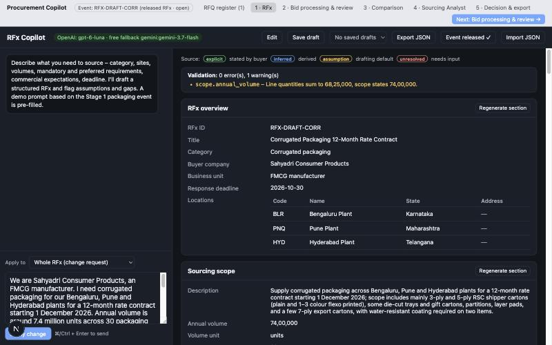
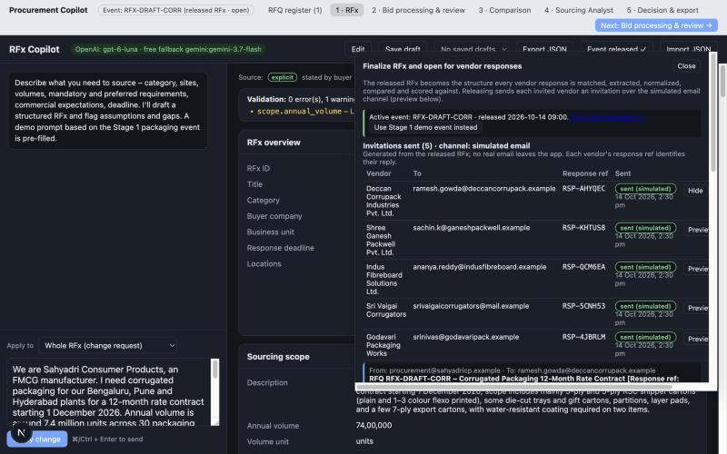
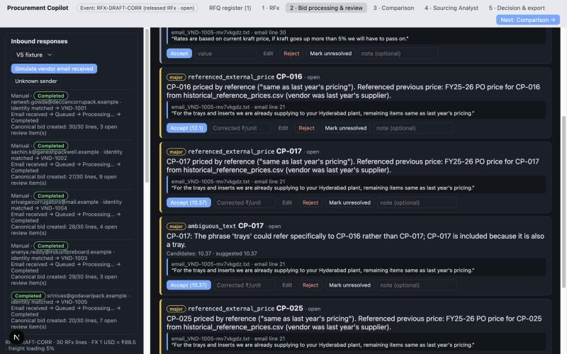
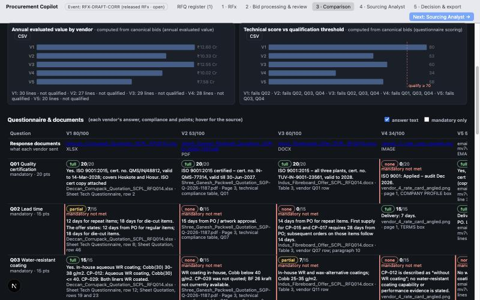
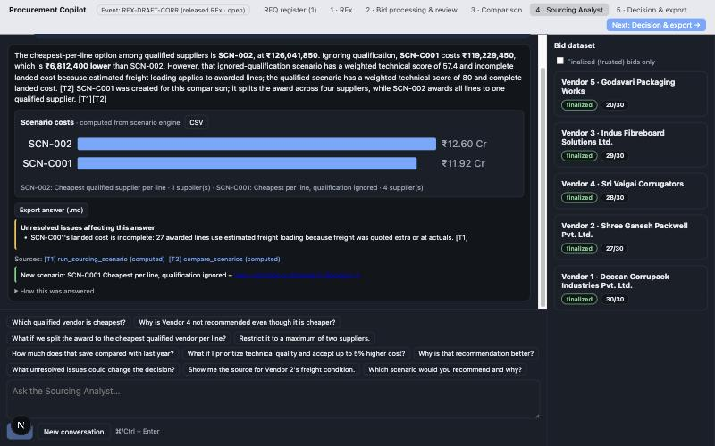
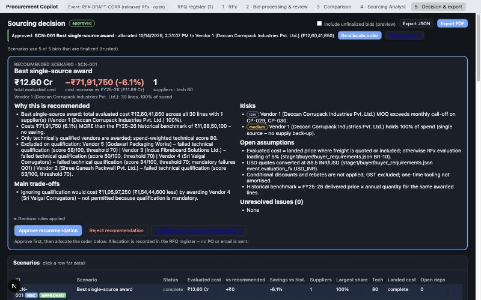
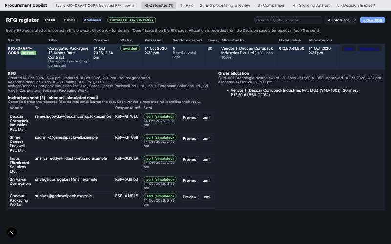

# Procurement Copilot – What We Built

Oct 14, 2026 · @aman tiwari

Procurement Copilot takes a buyer from a one-paragraph request to an audited award decision. It drafts the RFx, reads five vendor responses in five formats, normalizes them into one comparison, answers questions over it and records the order allocation.

## What it does

1. **Draft.** The buyer describes the need; the AI drafts the full RFx in about 20 s, each value tagged as stated, inferred, assumed or unresolved.
2. **Release.** Checks block an incomplete RFx; each vendor gets an invitation with its own response reference (simulated email).
3. **Receive.** Responses in any format by email, load or upload, through identity matching and a retrying queue; unknown senders wait for the buyer.
4. **Read and normalize.** The AI extracts quotes, terms and answers with source evidence; code converts units, currency and freight and flags exceptions.
5. **Review.** The buyer accepts, corrects or re-maps flagged items beside the evidence; every action recalculates the bid and is logged.
6. **Compare.** All vendors on 30 lines in one unit and currency, with scores, questionnaire answers, original documents and charts.
7. **Ask.** A natural-language analyst gives cited answers with tables, charts, what-if scenarios and exports.
8. **Decide.** The scenario engine recommends an award with reasons, risks and sensitivity; the buyer approves, allocates and exports; an RFQ register tracks it.

## The run in screenshots

One live run on 14 Oct 2026 with the built-in demo prompt and the five vendor files, on OpenAI.

**1. Draft.** The AI-drafted RFx with source tags; validation passes and flags that the 30 SKUs total 6.83 M units against the 7.4 M the buyer stated.

**2. Release.** Five invitations sent over the simulated email channel, each with its own response reference.

**3. Review.** Vendor 5’s “same as last year’s pricing” lines are flagged with the verbatim email line and a suggested price; left, the inbound queue for all five responses.

**4. Compare.** Evaluated value and technical score per vendor, then each vendor’s questionnaire answer, compliance, points and source document.

**5. Ask.** The VP’s question: the cheapest split among qualified vendors costs ₹12.60 Cr; ignoring qualification would cost ₹11.92 Cr but with a technical score of 57.4 and estimated freight.

**6. Decide.** The AI-drafted questionnaire made lead time, coating and freight pass/fail, so no vendor qualified; the buyer kept ISO 9001 mandatory, scored the other three and re-released. Only Vendor 1 clears 70 points, so the engine recommends a single-source award at ₹12.60 Cr, 6.1% above last year, with reasons, risks and trade-offs; approved and allocated.

**7. Register.** The RFQ shows as awarded, with the five invitations, the allocated vendor, order value and dates.

## Brief coverage

Every requirement is met; sending to vendors is simulated by choice.

| Brief asks for | Delivered |
| --- | --- |
| A realistic dataset: 5 vendors, 30 lines, questionnaire, documents | Corrugated packaging event, 30 SKUs, 14-question questionnaire, historical prices (below) |
| Messy responses: template-free Excel, PDF footnote, Word paragraph, angled photo, one-line email | One vendor per format, read without a template (below) |
| AI co-pilot that talks an RFx into existence | Generate, refine by chat, regenerate sections, edit everything |
| Out to vendors over a chosen channel | Per-vendor invitations and response references, simulated email |
| One side-by-side comparison: same lines, units, currency | Comparison on evaluated ₹/unit, landed where freight is known |
| Questionnaire answers and documents beside the numbers | Questionnaire matrix and links to each original file |
| Natural-language questions with text, tables, charts, exports | Sourcing Analyst with citations, charts, Markdown/CSV export |
| “Cheapest per line, only vendors who cleared the questionnaire” and a defensible award | Scenario SCN-002, custom scenarios, recommendation, audit trail, PDF export |

## The demo dataset

A fictional FMCG buyer, Sahyadri Consumer Products, runs its corrugated-packaging rate contract for three plants: 30 lines, about 6.83 M units and ₹11.9 Cr of FY25-26 spend. The responses carry 32 planted edge cases, checked only by the offline evaluation.

| Vendor | Format | What makes it hard | Lines quoted |
| --- | --- | --- | --- |
| 1 Deccan Corrupack | Excel, own layout | Notes in cell comments, freight in its own column, conditional rebate | 30/30 |
| 2 Shree Ganesh Packwell | PDF on letterhead | 2% discount in the closing terms, freight at actuals, one line quoted twice | 27/30 |
| 3 Indus Fibreboard | Word | Commercials in paragraphs, USD prices, conflicting validity dates | 29/30 |
| 4 Sri Vaigai Corrugators | Photo of a rate card | Angled, glare and partial versions; cheapest but fails ISO 9001 | 28/30 |
| 5 Godavari Packaging | Plain email | Rates per kg, “rest same as last year”, lines declined | 20/30 |

## How it works

- **AI reads, code calculates.** The model only extracts what documents say; conversions, scores, totals, scenarios and recommendations are deterministic code.
- **Evidence on every value.** Each price, term and answer keeps its file, location and verbatim text.
- **Flag, never guess.** Ambiguous rows, duplicates, conflicts, outliers and “same as last year” go to human review; decisions are stored beside the original extraction.
- **Grounded answers.** The analyst must cite tool results; code strips invented citations, flags unsupported figures and computes every chart value.

## Beyond the brief

- **Review workflow** with accept, correct, reject, unresolved and re-map, each recalculated and logged.
- **Ingestion queue and identity matching** by sender, domain, response reference and thread.
- **Scenario engine**: six standard and any custom scenario, plus “would the recommendation change if…” tests.
- **Decision audit trail and RFQ register** from draft to awarded, with order value and allocation date.
- **Provider fallback** from OpenAI to a free Gemini tier, recorded; bounded retries.
- **Offline evaluation** with frozen model and prompt versions, scored against hidden answers.

## Architecture

One Next.js 16 app in TypeScript with a stateless server, so it deploys to Vercel as is. Zod schemas define every structure and drive the model’s JSON output; OpenAI runs in strict structured-output mode. Excel, PDF, Word and images are read with SheetJS, unpdf, mammoth and sharp; the analyst uses BM25 search plus 24 deterministic tools. Working data lives in the browser. API keys stay on the server, and the evaluation answers are blocked from the runtime and the deployment.

## Quality

| Check | Result |
| --- | --- |
| Lines, prices, units, currency, normalized price, freight | 100% on every quoted line, all formats |
| Planted edge cases detected | 29 of 32 (90.6%) |
| Review flags | precision 88.9%, recall 100% |
| Decision engine checks | 16 of 16 passed |
| Live end-to-end run on OpenAI | Passed, 2 model calls, no retries |
| Automated tests | 151 passing |

Extraction scores come from the earlier Gemini configuration and should be re-run on OpenAI.

## Limitations and next steps

- **Data is per browser:** add a database and user accounts to share RFQs and decisions.
- **Email is simulated:** connect a mail provider for invitations and an inbox for replies.
- **No purchase order:** push approved allocations to the ERP.
- **Uploads cap near 3 MB on Vercel:** upload large files to storage first.
- **AI-drafted questionnaires can mismatch vendor answers:** let buyers import their standard questionnaire.
